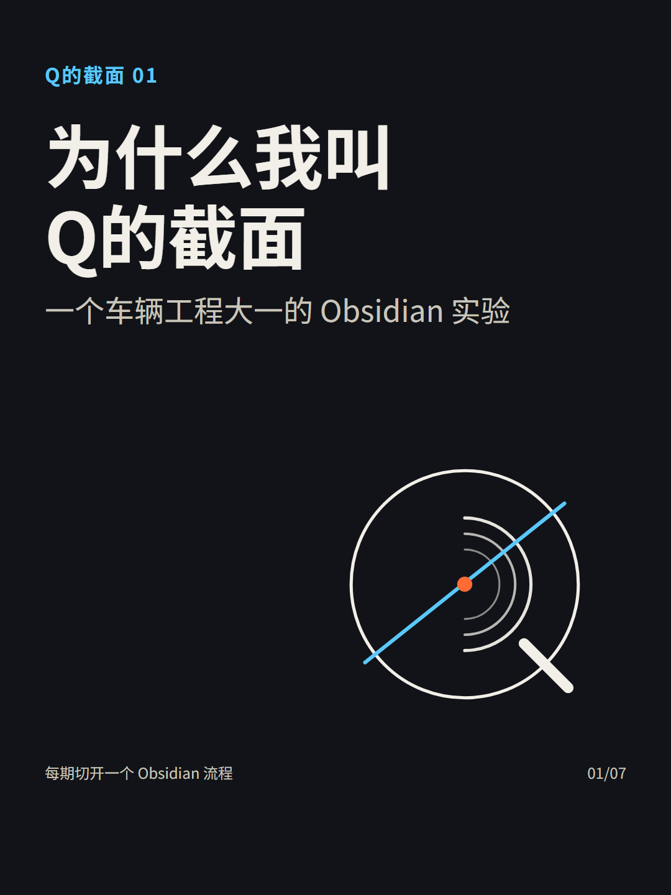

# Q的截面 / Q's Section

「Q的截面」是一个 Obsidian 内容系列：把一个笔记流程切开，看看里面怎么运作。这个仓库既是该系列可公开的素材与模板，也是自建 Obsidian 插件 **Q-Section** 的说明页。

*Q's Section* is an Obsidian content series: slice a note-taking workflow open and see how it actually works. This repository holds the series' shareable assets and templates, and documents the self-built Obsidian plugin **Q-Section**.

## 截图 / Screenshots




## 目录结构 / Structure

```text
assets/       头像（SVG）与封面（PNG）
templates/    7 图 HTML 模板（附模板内引用的头像）
LICENSE       MIT（仅覆盖本仓库自有代码与模板）
```

插件源码暂未发布到本仓库，这里先提供说明；是否开源由作者决定。
The plugin source is not published in this repository yet; this page documents it. Whether to open-source it is up to the author.

## 7 图模板 / 7-slide template

- `assets/cover-01.png` 是 1080×1440 的封面成品，可直接用于小红书 / B站图文。
- `templates/第一条内容-7图模板.html` 是完整的 7 图模板：在浏览器中直接打开即可看到 7 张 1080×1440 的 slide，改文字后按下面的方式导出。模板内引用的头像已放在同目录。
- 批量导出图文时建议：视口 1080×1440、`deviceScaleFactor=1`，等字体与图片加载完成后再截图，单张区域截取（不要整页截图后裁切）。

- `assets/cover-01.png` is a finished 1080×1440 cover, ready for social posts.
- `templates/第一条内容-7图模板.html` is a complete 7-slide template: open it in a browser to see seven 1080×1440 slides, edit the text, and export as described below. The avatar it references sits in the same folder.
- For batch export: use a 1080×1440 viewport with `deviceScaleFactor=1`, wait for fonts and images, and screenshot each slide element rather than cropping a full-page capture.

## Q-Section 插件 / The Q-Section plugin

当前版本 **0.14.3**。Current version: **0.14.3**.

它是自建的 Obsidian 插件，包含四部分：

It is a self-built Obsidian plugin with four parts:

- **Q 截面**：右侧栏数据视图，六个一级模块——截面、推进、产出、输入、节奏、系统。
- **Q 操作台**：专注番茄钟（可存专注集、倒计时/正计时、开始后浮动小窗）、项目打卡、新建对象、打开总览、路由入口。
- **自动路由**：按 frontmatter 的 `type` / `status` / `topic` / `note_kind` / `content_stage` / `period` 把笔记移动到对应目录。
- **独立主题**：Q 主题可跟随 Obsidian、强制浅色或深色；ins 风软表面按钮。

- **Q Section**: a sidebar data view with six top-level modules — Section, Push, Output, Input, Rhythm, and System.
- **Q Console**: a focus timer with saved presets, countdown or stopwatch mode, and a floating mini window while running; project check-ins, new-object shortcuts, dashboard entry points, and routing.
- **Auto-routing**: moves notes according to the `type` / `status` / `topic` / `note_kind` / `content_stage` / `period` frontmatter fields.
- **Independent theme**: the Q theme follows Obsidian, or stays light/dark on its own; soft-surface, ins-style buttons.

### 更新记录 / Changelog

- **0.14.3**：修复专注小窗按钮在深色 / 浅色下的对比度；关闭按钮保持透明。
- **0.14.2**：修复 Q 操作台按钮与打卡按钮沿用外部主题绿色 inset、深色不可读的问题。
- **0.14.1**：修复 Q 截面模块 tab / 子 tab 的绿色 inset 与深色对比；按钮回到 Q 品牌样式。
- **0.14.0**：新增独立 Q 主题（跟随 / 浅色 / 深色，可独立于 Obsidian 主题）与 ins 风按钮。
- **0.13.1**：面板背景改用 Q 品牌底（骨白 / 炭黑 + 冰蓝、橙点）；manifest 简介改中英双语。
- **0.13.0**：专注开始后显示可拖动的浮动小窗（暂停 / 继续 / 结束 / 操作台 / 收起）。
- **0.12.1**：专注集改为在原计时区设名称、方式与时长后保存；支持正计时。
- **0.12.0**：新增专注集（预设名称 + 时长），删除预设不影响打卡与日历。
- **0.11.1**：修复 Q 操作台「新建」对象的路径生成错误；修复 resource 在没有 `note_kind` 时被放入 `<Topic>/Other`、而不是主题根目录的问题。
- **0.11.0**：Q 截面六模块、Q 操作台、自动路由。

- **0.14.3**: improved contrast of the focus mini-window buttons in light and dark themes; the close button stays transparent.
- **0.14.2**: fixed Q Console and check-in buttons inheriting the external theme's green inset and becoming unreadable in dark mode.
- **0.14.1**: fixed the green inset and dark-mode contrast on Q Section module and sub tabs; buttons restored to the Q brand style.
- **0.14.0**: added an independent Q theme (follow / light / dark, independent of the Obsidian theme) and ins-style buttons.
- **0.13.1**: panels use the Q brand background (bone white / charcoal with ice-blue and orange accents); manifest description is now bilingual.
- **0.13.0**: a draggable floating mini window appears while a focus session runs (pause / resume / finish / console / collapse).
- **0.12.1**: focus presets are now set in the original timer area (name, mode, duration) before saving; stopwatch mode supported.
- **0.12.0**: added focus presets (name + duration); deleting a preset does not affect check-ins or the calendar.
- **0.11.1**: fixed path generation when creating new objects from Q Console; fixed resources without `note_kind` being placed in `<Topic>/Other` instead of the topic root.
- **0.11.0**: six-module Q Section, Q Console, and auto-routing.

### 安装 / Installation

如果源码公开，把 `main.js`、`styles.css`、`manifest.json` 放进 `<vault>/.obsidian/plugins/qsection/`，重启 Obsidian 并在社区插件中启用。

If the source is published, copy `main.js`, `styles.css`, and `manifest.json` into `<vault>/.obsidian/plugins/qsection/`, restart Obsidian, and enable the plugin under Community plugins.

仓库不包含 `data.json`。它保存草稿、写作目标、打卡、专注等个人数据，只在本地使用，不随仓库分发。

This repository does not include `data.json`. It stores personal data such as drafts, writing goals, check-ins, and focus sessions; it stays local and is never distributed with the repository.

## 来源与边界 / Scope

- 头像与封面均为自制素材；模板来自作者自己的 Obsidian 使用流程。
- 插件部分只描述公开功能，不含个人数据、账号信息或密钥。
- 仓库不包含个人笔记正文、账号信息、学校或位置信息，也不包含任何密钥。

- All visuals are original; templates are drawn from the author's own Obsidian workflow.
- The plugin section describes public features only and includes no personal data, account details, or secrets.
- No personal notes, account details, school or location information, or secrets are included.

## 许可 / License

MIT，仅覆盖本仓库中的自有代码与模板。
MIT, covering only the original code and templates in this repository. See [LICENSE](LICENSE).
